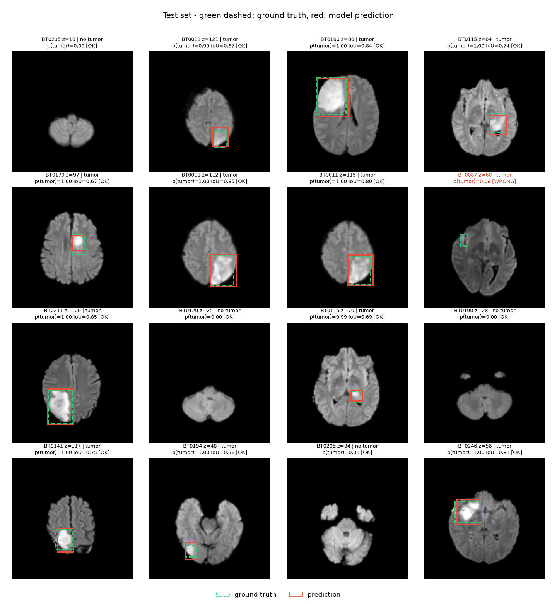
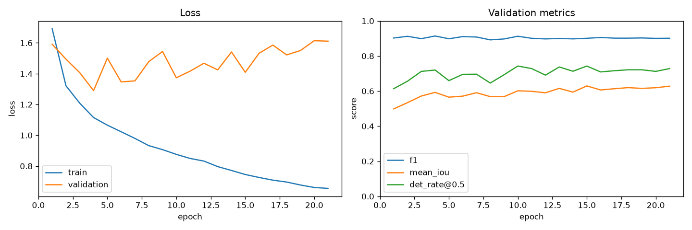

# Brain Tumor Localization in MRI with PyTorch

A compact deep-learning pipeline that reads brain MRI scans, decides for every axial slice whether it contains a **glioma**, and draws a **bounding box** around the tumor. It covers the full workflow: downloading the data, preprocessing, a patient-level data split, training, evaluation and visualization. The model is small enough to train on a MacBook in about 11 minutes.


*Held-out test patients. Yellow dashed box is the radiologist-derived ground truth; red solid box is the model prediction. The yellow/red pair (plus dashed vs. solid lines) stays readable for red-green color-blind viewers.*

---

## Results

Held-out **test set**: 23 patients never seen during training or model selection, 2,097 slices, 1,134 of them with tumor. Training used 104 patients, and validation 23 patients for model selection. Training took about 11 minutes on a MacBook Pro (M4, MPS).

| Task | Metric | Test |
|---|---|---|
| Tumor present? | Accuracy | **0.924** |
| | Precision / Recall | 0.931 / 0.928 |
| | F1 | **0.929** |
| Where is it? | Mean IoU (tumor slices) | **0.659** |
| | Median IoU | 0.739 |
| | Detected **and** IoU ≥ 0.5 | **80.2%** |

On the training curves:
- Validation loss is lowest around epoch 4, while the localization metrics keep improving until about epoch 15.
- Training loss keeps falling after that, so the model starts overfitting the 104 training patients.
- Early stopping on the validation score picks epoch 15.
- The usual next step is more patients (`data.num_patients`) or stronger regularization.

Most misses are very small or faint lesions at the top or bottom edge of a tumor, where even the ground-truth box is only a few pixels wide.

More examples: [assets/test_predictions_2.png](assets/test_predictions_2.png). Sanity check of the ground-truth boxes after augmentation: [assets/sanity_samples_augmented.png](assets/sanity_samples_augmented.png).



---

## Dataset

[**UTSW-Glioma**](https://www.cancerimagingarchive.net/collection/utsw-glioma/) on The Cancer Imaging Archive (TCIA):

- 625 adult glioma patients from UT Southwestern, scanned between 2006 and 2023.
- Pre-operative MRI in four contrasts: T1, T1 post-contrast, T2 and T2-FLAIR.
- Images are skull-stripped and co-registered to 240 × 240 × 155 at 1 mm.
- Multi-label tumor segmentations: enhancing tumor, necrotic core and edema. 362 of them were manually refined by neuroradiologists.
- Clinical metadata: grade, IDH status, MGMT and more.

What this project uses:

- **Patients:** the first `data.num_patients` patients (150 by default).
- **Input:** the skull-stripped **FLAIR** scan, which is where the whole tumor extent, including edema, is most visible.
- **Labels:** the tumor masks. The manually refined mask is used when one exists, otherwise the automatic FeTS mask.

The masks are used only to **derive the box targets**. The model itself never sees a mask.

> Data license: CC BY 4.0. Please cite:
> Reddy, D., Saadat, N., Holcomb, J., Wagner, B., Truong, N., Bowerman, J., Hatanpaa, K., Patel, T., Pinho, M., Yu, F., Zhang, K., Lodhi, S., Madhuranthakam, A., Bangalore Yogananda, C. G., & Maldjian, J. (2026). *The University of Texas Southwestern Glioma MRI dataset with molecular marker characterization and segmentations (UTSW-Glioma)* (Version 1) [Data set]. The Cancer Imaging Archive. https://doi.org/10.7937/DFAE-1B86

---

## Method

```
NIfTI volume (240x240x155)
  │  normalize intensities (brain-only percentiles) → [0, 1]
  │  cut into axial slices, drop near-empty ones
  │  label: tumor (≥ 50 tumor px) / no tumor; balance negatives 1:1
  ▼
2D slice 128x128 ──► ResNet-18 (ImageNet init, 1-channel) ──► 512×4×4 feature map
                                                         │
                               1×1 conv + flatten + FC (keeps spatial layout)
                                     ┌───────────────┴───────────────┐
                              cls head: p(tumor)            box head: (cx, cy, w, h)
```

| Component | Choice | Why |
|---|---|---|
| Split | By **patient**: 70 / 15 / 15, stratified by tumor grade | Slices of one patient are near-duplicates. Splitting by slice would leak test data into training. |
| Backbone | ResNet-18, about 11.8M parameters | Pretrained, small, fast on Apple-silicon GPUs (MPS). |
| Box head | Flattened 4×4 feature map, not global pooling | Global pooling throws away *where* things are, which is exactly what box regression needs. |
| Loss | BCE + SmoothL1 + GIoU | BCE trains the classifier. L1 gets the coordinates right. GIoU optimizes overlap directly and still has a gradient when the boxes don't overlap. Box terms apply only to tumor slices. |
| Augmentation | Flip, rotation, zoom, shift, brightness/contrast | Applied to the image **and** its mask together, then the box is recomputed from the augmented mask, so it always stays aligned. |
| LR schedule | 2-epoch warm-up, then **reduce-on-plateau**: LR × 0.3 when validation mean IoU stalls for 3 epochs | The model gets its low-LR fine-tuning phase when validation says it has stalled. A fixed cosine schedule only does that at a pre-chosen final epoch. |
| Early stopping & model selection | Monitor **validation mean IoU**. Keep the best checkpoint, and stop after 10 epochs with no gain above 0.002, at most 60 epochs | IoU is the weakest metric, so it decides when to stop. Patience 10 is above the LR patience of 3, so the model gets 2–3 LR drops before training ends. |

Metrics reported on the held-out test patients:

- **Accuracy, precision, recall and F1**, for "does this slice contain a tumor?"
- **Mean and median IoU**, between the predicted and true box on tumor slices.
- **det_rate@0.5**: the share of tumor slices that are both detected and localized with IoU ≥ 0.5.

---

## Project structure

```
├── configs/config.yaml          # every hyperparameter and path, commented
├── notebooks/colab_train.ipynb  # train + evaluate on a Google Colab GPU
├── scripts/                     # command-line entry points
│   ├── download_data.sh         # installs the Aspera CLI if needed, then downloads
│   ├── download_data.py
│   ├── preprocess.py            # volumes → slice cache + patient split
│   ├── visualize_samples.py     # sanity check: ground-truth boxes (± augmentation)
│   ├── train.py
│   └── evaluate.py
├── src/mri_tumor/
│   ├── config.py                # YAML loader, device selection, seeding
│   ├── data/
│   │   ├── download.py          # selective Aspera download of only the needed files
│   │   ├── preprocess.py        # normalization, slicing, labeling, caching
│   │   ├── split.py             # patient-level stratified split
│   │   └── dataset.py           # Dataset + mask-aware augmentation + box extraction
│   ├── models/detector.py       # TumorDetector
│   ├── losses.py                # detection loss
│   ├── metrics.py               # classification + IoU metrics
│   ├── train.py                 # training loop, LR schedule, checkpointing, early stopping
│   ├── evaluate.py              # test metrics + prediction figures
│   └── visualize.py             # plotting helpers
├── assets/                      # figures shown in this README
├── data/        (git-ignored)   # raw/, processed/, metadata/
└── outputs/     (git-ignored)   # checkpoints/, logs/, figures/, metrics.json
```

---

## Getting started

Tested on a MacBook Pro (Apple M4), Python 3.13 and PyTorch 2.x. The code picks the best device automatically: MPS, then CUDA, then CPU.

```bash
# 1. Environment
python3 -m venv .venv && source .venv/bin/activate
pip install -r requirements.txt

# 2. Data: metadata + FLAIR & tumor mask for the first 150 patients (~710 MB, ~8 min)
bash scripts/download_data.sh                # or: --num-patients 50

# 3. Preprocess: slice cache + train/val/test split (~1 min)
python scripts/preprocess.py
python scripts/visualize_samples.py --augment   # optional sanity check

# 4. Train (~11 min on an M4 MacBook Pro, ~30 s/epoch)
python scripts/train.py

# 5. Evaluate on the test patients and open the prediction figures
python scripts/evaluate.py --show
```

### Training on Google Colab

[`notebooks/colab_train.ipynb`](notebooks/colab_train.ipynb) runs the same scripts on a Colab GPU:

1. Upload your local `data/processed/` folder, about 100 MB, to `MyDrive/MRI_tumor_identification/data/processed/`. This keeps the patient split identical to local runs.
2. Open the notebook in Colab (*File → Open notebook → GitHub*) and pick a GPU runtime.
3. Run all cells.

The notebook clones the repo, writes `configs/colab.yaml` with outputs pointing to Drive, then trains, evaluates and displays the metrics and figures. Checkpoints and logs are saved to `MyDrive/MRI_tumor_identification/outputs/<RUN_NAME>/`, so they survive a disconnect.

### About the download

TCIA distributes the UTSW-Glioma images only through **IBM Aspera**. The full collection is 22.9 GB.

`scripts/download_data.sh` handles this:

1. If needed, it installs the open-source [`aspera-cli`](https://github.com/IBM/aspera-cli) through Homebrew Ruby. The Ruby that ships with macOS is too old.
2. It then asks the Faspex server for **only** the files the project needs: about 5 MB per patient instead of about 37 MB.
3. Downloads are parallel and resumable.

If the CLI route fails, use the fallback: download the collection in the browser with *IBM Aspera Connect* from the TCIA page, and place the patient folders (`BT0001/…`) in `data/raw/`.

### Configuration

Every tunable value is in [`configs/config.yaml`](configs/config.yaml), with a comment explaining it. This covers the number of patients, MRI modality, image size, class balance, split ratios, model, optimizer, loss weights, augmentation strength and evaluation settings. To run an experiment, copy the file and pass it to any script:

```bash
python scripts/train.py --config configs/my_experiment.yaml
```

Early stopping is controlled in the `train:` section:

| Key | Default | Meaning |
|---|---|---|
| `monitor` | `mean_iou` | Validation metric that picks the checkpoint, lowers the LR and stops training. Options: `mean_iou`, `score` (0.5·F1 + 0.5·IoU), `f1`, `det_rate@0.5`, `val_loss`. |
| `min_delta` | `0.002` | The smallest gain that counts as an improvement. |
| `scheduler` | `plateau` | `plateau` lowers the LR when the monitored metric stalls. `cosine` uses a fixed decay over `epochs`; in that case set `patience >= epochs`, because stopping early would cut off the low-LR tail. |
| `lr_factor`, `lr_patience` | `0.3`, `3` | Multiply the LR by `lr_factor` after `lr_patience` epochs without improvement. |
| `patience` | `10` | Stop after this many epochs without improvement. |

---

## Limitations and ideas

- **One box per slice.** Multifocal tumors get a single box around all lesions. A multi-object detector, such as Faster R-CNN or DETR, would separate them.
- **2D slices.** Context from neighbouring slices is ignored. Stacking adjacent slices as channels, or a light 3D model, could help.
- **Single modality.** FLAIR shows the full tumor extent. Adding T1 post-contrast as a second channel would help separate the enhancing core.
- **Not for clinical use.** This is a portfolio and educational project.

## License

The code is MIT-licensed. The data is CC BY 4.0, from TCIA; see the citation above.
